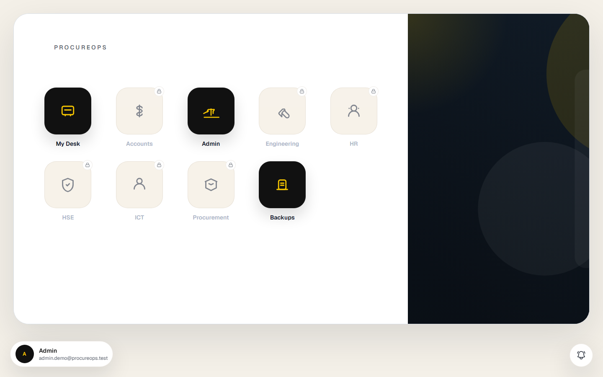
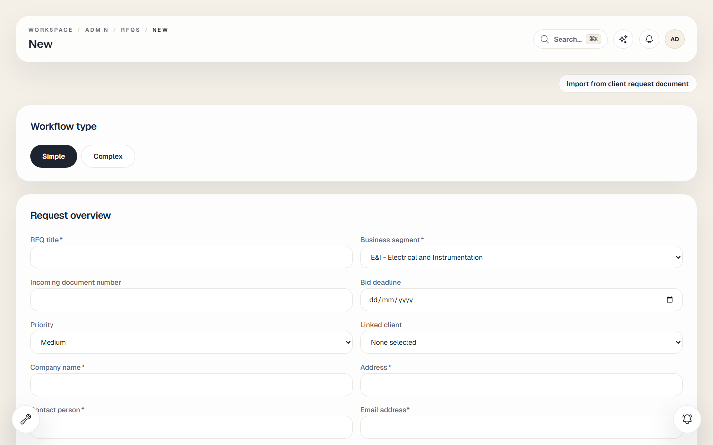
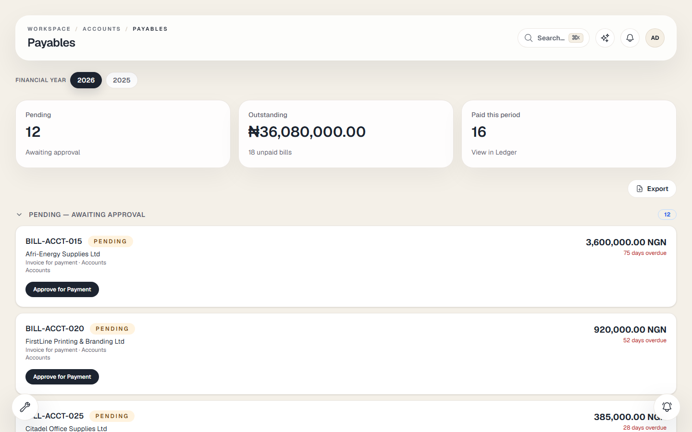
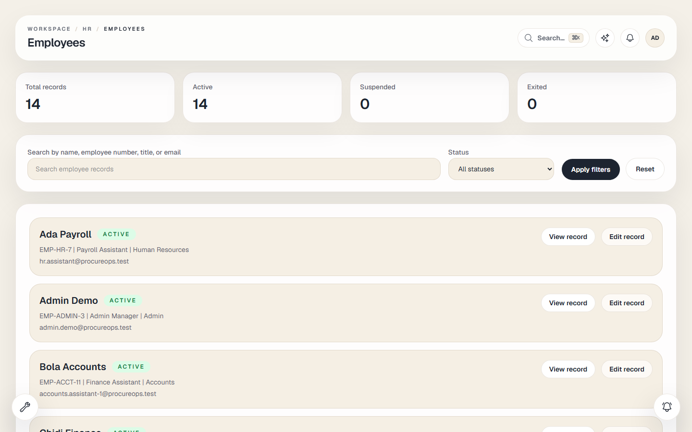
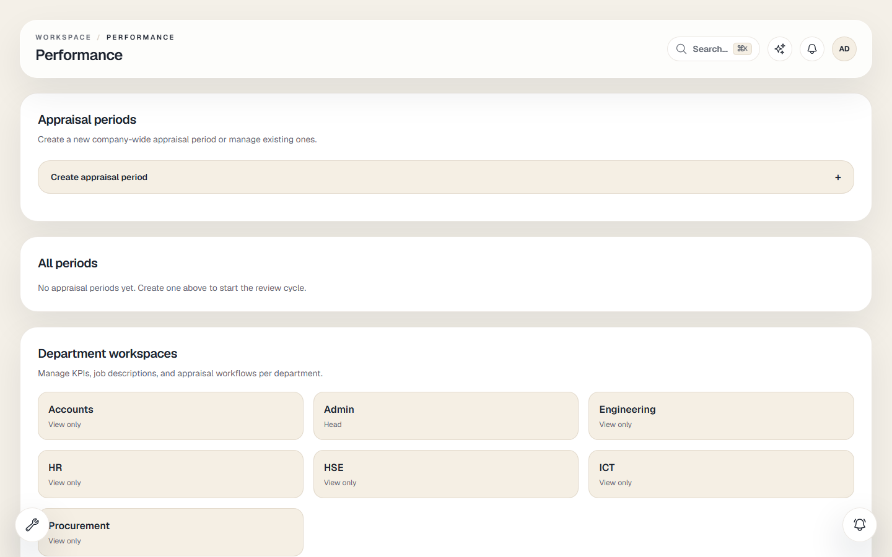
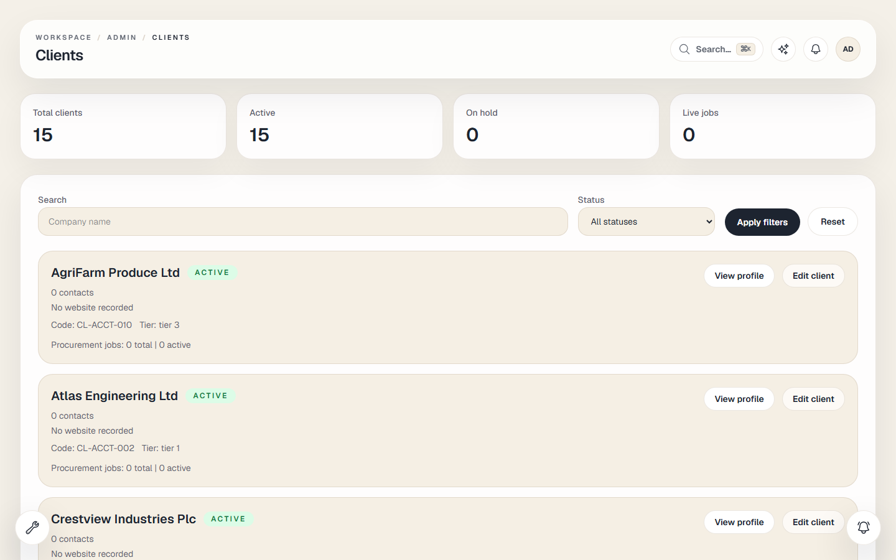
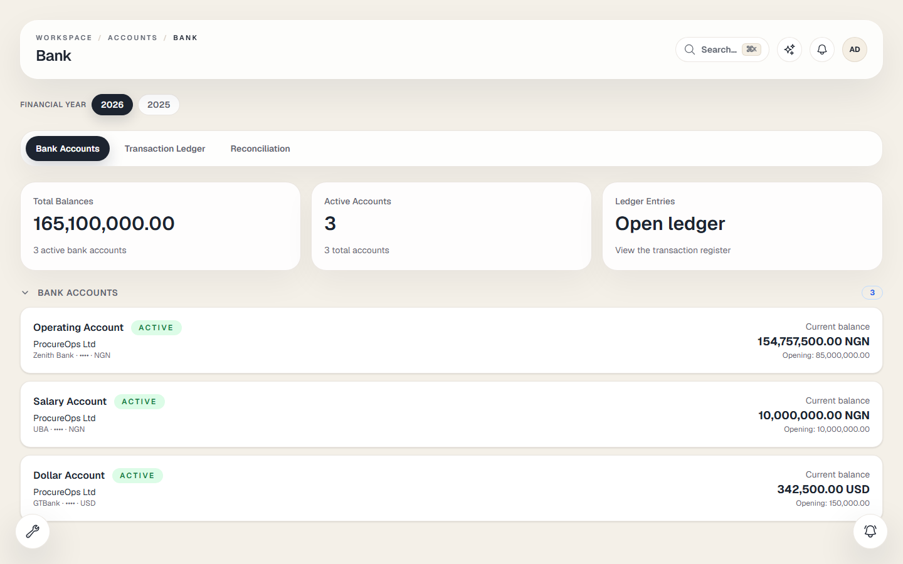

# ProcureOps — Procurement & Operations ERP

> An internal operations platform for a procurement firm serving engineering-sector clients: RFQs and supplier quotations, purchase orders, freight and clearing, client billing, full accounts (including bank-statement reconciliation), HR and payroll, compliance, documents and audit — organised as a department workspace rather than one giant app.

| | |
|---|---|
| **Role** | Solo — product design, architecture, backend API, frontend, deployment |
| **Timeline** | 2026 – present · 1,628 commits |
| **Stack** | Laravel 13 · PHP 8.4 · Next.js 16 (App Router) · React · TypeScript · Tailwind · MySQL · Redis · Docker · GitHub Actions |
| **Size** | 297 migrations · 14 department modules · deployed to a production VPS |

> **The source code for this project is private.** This repository is a technical case study with real screenshots from the running application. Code walkthroughs available on request.

---

## The problem

Procurement firms in oil & gas and engineering sit between a client's technical request and a supplier's capacity to deliver. Work arrives as a document, gets broken into line items, sent to suppliers as RFQs, compared, awarded, purchased, freighted, cleared, invoiced and paid — and every step has an approval, a document and someone accountable for it.

Generic ERPs model this badly: they assume you are a manufacturer, and they treat "department" as a label. ProcureOps is modelled around the actual operating unit — the department — and around documents as first-class objects.

---

## Product tour

### Department workspace



The landing screen is the workspace, not a dashboard. Each tile is a department with its own scope — My Desk, Accounts, Admin, Engineering, HR, HSE, ICT, Procurement, Backups — and access is enforced server-side, not by hiding tiles. A user sees their departments; the tiles they cannot open are visibly locked.

### RFQ authoring



RFQs support **simple and complex workflows**, business-segment classification (E&I, mechanical, civil, …), priority, bid deadlines and a linked client. Critically, an RFQ can be **imported from a client request document** — the line items are extracted rather than retyped, which is where most manual error lives.

### Accounts payable and invoices



Bills are grouped by state (pending approval, outstanding, paid this period) with overdue age and an explicit "approve for payment" action. Amounts, ageing and dueness are computed from the bill register rather than stored per view.


The same register pattern covers client invoices, receipts and reconciliation, with a financial-year boundary and archiving.

### HR and performance



Employee records with employee number, job title and department, plus filtering and full CRUD.



Performance management is a workflow, not a table: appraisal periods, KPI templates, self-scoring, supervisor review, cumulative ratings and reminder notifications — including recent work on self-rating waivers for individual members.

### Clients and banking





Clients, clearing agents, freight forwarders and service providers each get a proper register with their own detail views. On the accounts side, a bank register with statement import and reconciliation closes the loop between the ledger and the bank.

---

## What is in the system

### Procurement
- RFQ lifecycle: draft → sourcing → quotes → award, with templates, projects and reporting
- Supplier/vendor register with categories, statuses (active, suspended, blacklisted) and codes
- Client request **document ingestion** with extraction and review (PDF/statement/RFQ parsing)
- Purchase orders, receipts, delivery tracking, freight forwarders and clearing agents
- Product atlas: a curated catalogue of engineering items, OEMs and rankings used during sourcing

### Accounts
- Invoices, bills, payables, receivables, receipts and payments
- Bank accounts, statement import, bank reconciliation hub, payment runs and authorisations
- Statutory obligations and remittances, financial years and archiving
- Expense claims, company loans, asset financials and payroll posting
- Reports and exports, including PDF rendering with a table-fitting pipeline

### HR
- Employees, onboarding, exit, leave, departments and capability groups
- Payroll: periods, components, allowances, loans, statutory configuration, payslips
- Performance: KPI templates, appraisal periods, self-appraisal, supervisor review
- Recruitment, policies and certifications; employee documents

### Cross-cutting
- **Department-first access model**: permissions are granted per department capability, and every route is guarded by middleware (`auth → active.user → password.change.required → onboarding.access`)
- Document register, generated documents, exports and templates
- Audit log, activity trails, notifications and email templates
- Backups with progress, restore runbooks and a latest-backup view
- Help centre with searchable articles, plus an assistant
- **AI assistant** with tool-style actions (the backend exposes an assistant controller and an action controller; the frontend proxies through `/api/assistant/chat` and `/api/assistant/actions`) — designed to answer questions about the user's own permitted data

---

## Architecture

```
┌──────────────────────────────────────────────────────────────┐
│  Next.js 16 (App Router) — src/modules/*                      │
│    Department-scoped routes, API client, permission-aware UI  │
└───────────────────────────┬──────────────────────────────────┘
                            │  JSON /api/v1
┌───────────────────────────▼──────────────────────────────────┐
│  Laravel 13 API                                              │
│                                                              │
│  Route → Middleware → Controller → FormRequest                │
│        → Service (transaction + audit + notifications)        │
│        → Model → API Resource                                 │
│                                                              │
│  Policies / department capabilities / role permissions        │
│  Queue workers · Scheduler · Storage · PDF (DomPDF/Gotenberg) │
└───────────────────────────┬──────────────────────────────────┘
                            │
                ┌───────────▼───────────┐
                │  MySQL + Redis        │
                └───────────────────────┘
```

### The conventions that keep it maintainable

A system with 297 migrations and fourteen modules collapses without enforced structure. The repository defines them explicitly in `AGENTS.md` and `docs/architecture.md`:

- **Thin controllers.** Authorise at the top of the method, pass `$request->validated()` and the user into a service. Business logic never lives in a controller.
- **Services own transactions.** Every multi-table write is wrapped in `DB::transaction`, writes an audit entry and dispatches notifications.
- **API Resources shape responses.** Fields are permission-gated in the resource layer (`whenLoaded`, conditional fields) so the UI cannot leak what the API should not send.
- **FormRequests own validation and authorisation shape.** Validation rules live next to the request, not in the controller.
- **Full vertical slices.** A feature is not done until schema, validation, authorisation, service logic, API response, frontend integration and docs all exist — the repo explicitly forbids half-wired UI.

### Engineering decisions worth calling out

1. **Department as the security and navigation primitive.** Both the sidebar and the API guards derive from one capability model, so the UI and the server cannot disagree.
2. **Documents as objects.** RFQ import, generated documents, templates and the document register mean the paperwork is part of the data model, not an afterthought.
3. **Financial-year boundaries and archiving.** Money data needs a period model; treating "the year" as a filter is how reporting bugs happen.
4. **Reconciliation as a first-class flow.** Statement import, matching, authorisation and payment runs are separate, auditable steps.
5. **Deployment as code.** GitHub Actions deploys to a VPS with environment-scoped secrets, concurrency protection, per-target deploys (frontend/backend/all) and a frontend build verification gate before any SSH step.
6. **Backups with a restore runbook.** A backup you have not restored is a rumour; the repo carries both the operator guide and the technical runbook.

---

## Testing and quality

- PHPUnit feature tests across modules, with a dedicated `procureops_test` database
- Seeded demo datasets (`AccountsDemoSeeder`, `HrPayrollDemoSeeder`, `StatementsDemoSeeder`, `DemoServiceProviderSeeder`, `CompanyLoansDemoSeeder`) so every workflow can be exercised end to end
- Explicit demo-user matrix (`DEMO_USERS.md`) mapping accounts to the workflows each one can prove — used for manual verification of permission boundaries
- Static analysis and lint gates in CI, plus a frontend build verification step ahead of deployment

---

## Status

In production use, with continued delivery across HR, performance management, accounts and the assistant. Actively being hardened for multi-department rollout.

---

## Why this project is representative

ProcureOps is the largest system I have built and the best demonstration of how I work with AI agents on a long-lived codebase: a written constitution (`AGENTS.md`), architecture rules, build rules and phase plans — then agents implementing against those rules, with tests, audit trails and CI as the guard rails. It is also where I learned that the hard part of a big system is not writing features; it is keeping fourteen modules pointing in the same direction six months later.
